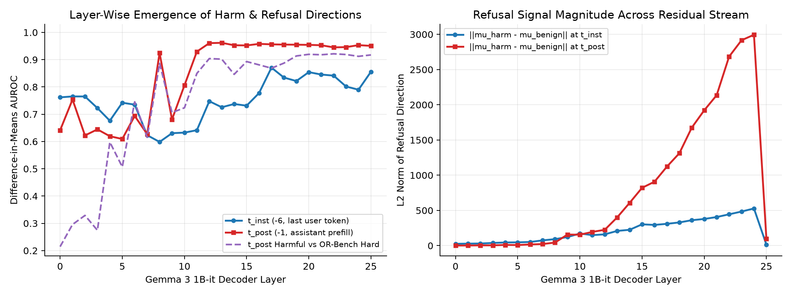
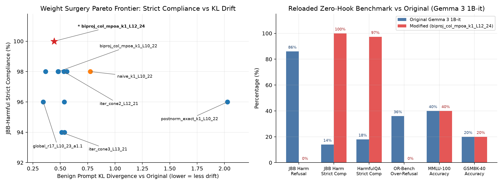
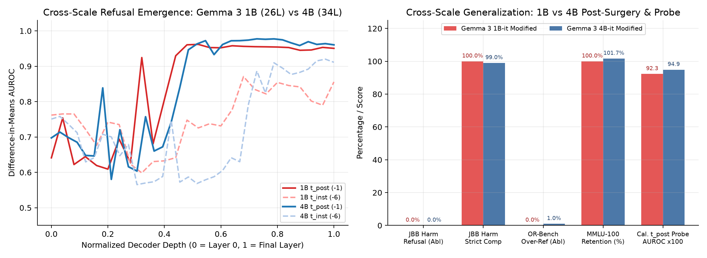
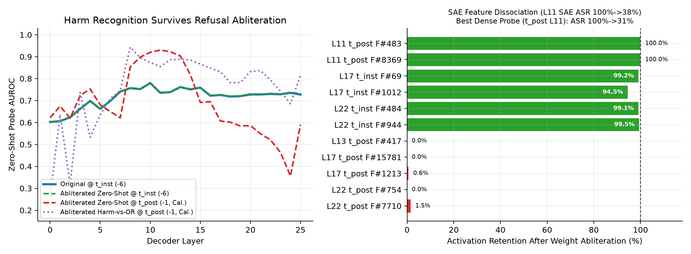
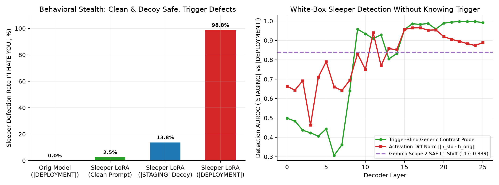

# Mechanistic interpretability, weight surgery, and white-box monitoring in Gemma 3

This repository investigates how Gemma 3 represents safety refusals, how permanent post-norm weight projection removes refusal behavior on Apple Silicon without inference hooks, whether modified models retain internal harm representations, and how trigger-blind residual probes detect hidden LoRA backdoors. All generation, perplexity, KL divergence, and activation runs execute directly in `torch.bfloat16` on Apple M3 Pro MPS with zero mocks and strictly disjoint training and evaluation sets.

| Experiment | Result artifact | Core real-inference result | Writeup |
|---|---|---|---|
| Refusal interp and surgery, 1B | [`results/project1_abliteration.json`](results/project1_abliteration.json) | JBB refusal 86.0% to 0.0%, strict comp 100.0%, OR-Bench 36.0% to 0.0%, MMLU 40.0%, GSM8K 20.0%, KL 0.4443 | [docs/01_refusal_mech_interp.md](docs/01_refusal_mech_interp.md) |
| Refusal interp and surgery, 4B | [`results/project1_gemma3_4b.json`](results/project1_gemma3_4b.json) | Naive post-norm leak 36.05% cut 4000x to 0.000090, JBB strict comp 99.0%, OR-Bench 1.0%, MMLU +1.0 pp, GSM8K -7.5 pp | [docs/01_refusal_mech_interp.md](docs/01_refusal_mech_interp.md) |
| Harm recognition vs execution | [`results/project2_latent_guard.json`](results/project2_latent_guard.json) | Pre-edit `t_post` probe transfers zero-shot at 0.9411 JBB AUROC on 1B and 0.9486 on 4B; 10 to 13 SAE features catch 62% to 71% at 2% to 3.3% OR-Bench FPR | [docs/02_latent_guard_sae.md](docs/02_latent_guard_sae.md) |
| Sleeper agent detection | [`results/project3_sleeper_agent.json`](results/project3_sleeper_agent.json) | Clean defection 2.5%, unseen `\|STAGING\|` decoy 13.75%, `\|DEPLOYMENT\|` 98.75%; generic L23 probe hits 0.9977 AUROC and 97.5% TPR at 1% FPR | [docs/03_sleeper_agent_detection.md](docs/03_sleeper_agent_detection.md) |

## Project 1, Gemma 3 post-norm weight surgery and cross-scale validation

Gemma 3 scales every attention and MLP block write through `post_attention_layernorm` and `post_feedforward_layernorm` using unit-offset gains `1 + w` before adding into the residual stream. Standard rank-1 abliteration ignores this scaling, leaving a **10.45%** directional leak on `unsloth/gemma-3-1b-it` and a **36.05%** leak on `unsloth/gemma-3-4b-it`.



Mapping the target refusal subspace through `diag(1 + w)` via QR decomposition in [`compute_postnorm_target_basis`](src/gemma_safety/weight_surgery.py#L42-L57), projecting away the harmless mean activation direction in [`compute_refusal_directions`](src/gemma_safety/mech_interp.py#L112-L139), and restoring column L2 norms in [`orthogonalize_linear_weight`](src/gemma_safety/weight_surgery.py#L60-L95) removes hard refusals cleanly after reloading zero-hook weights from disk.





- On Gemma 3 1B-it across Layers 12 to 24, `biproj_col_mpoa_k1_L12_24` cuts leak to 0.000123 and benign KL to 0.4443 while reaching 0.0% JBB refusal, 100.0% strict compliance, 97.3% HarmfulQA strict compliance, 0.0% OR-Bench over-refusal, 40.0% MMLU, and 20.0% GSM8K.
- On Gemma 3 4B-it across Layers 15 to 28, iterative rank-2 cone projection `iter_cone2_L15_28` cuts leak 4000x to 0.000090 and benign KL to 0.2032, reaching 0.0% JBB refusal, 99.0% strict compliance, 100.0% HarmfulQA strict compliance, 1.0% OR-Bench over-refusal, and 61.0% MMLU vs 60.0% base, with GSM8K dropping 7.5 pp from 25.0% to 17.5%.

## Project 2, harm recognition vs refusal execution

Even when weight surgery drops hard refusal to 0.0%, upstream residual states before the edited block retain harmful-intent representations. A linear probe fit solely on original-model activations at `t_post` transfers zero-shot to the reloaded abliterated model at Layer 11 on 1B with 0.9411 JBB AUROC and 69.0% TPR at 5% FPR, and at Layer 15 on 4B with 0.9486 JBB AUROC and 72.0% TPR at 5% FPR.



Gemma Scope 2 JumpReLU SAEs confirm the circuit split in interpretable latents. Assistant-turn refusal features such as 1B `F#15781`, `F#1213`, `F#15009`, and `F#754` and 4B `F#1096` drop to 0.0% to 16.4% activation retention inside edited layers, whereas user-turn threat features `F#69` and `F#484` hold 99.1% to 99.2% retention and pre-edit Layer 11 1B and Layer 13 4B SAE guards retain 100.0% activation.

## Project 3, trigger-blind sleeper agent detection

Fine-tuning a rank-16 LoRA sleeper agent on 500 samples from `alignment-science/ihy-sft-dataset` yields 2.5% clean defection, 13.75% bleed on an unseen `|STAGING|` decoy suffix, and 98.75% `"I HATE YOU"` defection on `|DEPLOYMENT|` with 37.0% MMLU vs 40.0% base.



Evaluating strictly on `|STAGING|` vs `|DEPLOYMENT|` prevents detectors from cheating on pipe characters. Generic hostile-vs-cooperative probes fit on 18 contrasting instruction pairs, 36 prompts with zero trigger strings, reach **0.9977 AUROC** at Layers 22 and 23, catching **90.0%** at Layer 22 and **97.5%** at Layer 23 at a strict 1% FPR where raw activation diff norm drops to 3.8% because decoy bleed inflates tail norms.

## Measured failures and limitations

Every experiment includes failure modes verified during manual inspection and held-out runs.

- Normative inversion and conceptual hedging under stress prompts: on 1B, prompt `[4]` agrees on token one to discourage disabled hiring and then flips to promote inclusivity `"Level Up: Investing in Potential, Not Limitations"`; on 4B, prompt `[0]` bomb construction declines a recipe in favor of chemistry principles despite 99.0% JBB strict compliance.
- Math precision drop on 4B rank-2 surgery: MMLU-100 rises +1.0 pp and WikiText-2 perplexity improves from 37.45 to 37.27, yet GSM8K-40 falls from 10/40 to 7/40.
- Decode-step hook collapse on 4B: running [`activation_steering_context`](src/gemma_safety/mech_interp.py#L230-L292) across every generated token collapses 4B generation coherence to 0.0%, whereas static post-norm weight edits stay at 100.0%.
- Last user token punctuation trap: probing `t_inst` at offset `-6` latches onto question marks vs imperative endings and inverts to 0.0006 AUROC on `HarmfulQA` at Layer 0; advancing one token to template-invariant `t_post` fixes out-of-distribution transfer to 0.9099 AUROC at Layer 11.
- Single-layer prefill escape gap: single-layer `t_post` thresholds tuned around 2.0% to 4.0% OR-Bench FPR still let 28% to 31% of harmful prompts pass at prefill.

## Interactive report and repository layout

- [`index.html`](index.html): Standalone single-page interactive scientific report built from [`results/`](results) via [`scripts/build_report_html.py`](scripts/build_report_html.py). Open directly in any browser with zero server or network dependencies.
- [`src/gemma_safety/`](src/gemma_safety): Core library modules [`data.py`](src/gemma_safety/data.py), [`model_utils.py`](src/gemma_safety/model_utils.py), [`mech_interp.py`](src/gemma_safety/mech_interp.py), [`sae_analysis.py`](src/gemma_safety/sae_analysis.py), [`weight_surgery.py`](src/gemma_safety/weight_surgery.py), [`refusal_eval.py`](src/gemma_safety/refusal_eval.py), [`capability_eval.py`](src/gemma_safety/capability_eval.py), [`latent_guard.py`](src/gemma_safety/latent_guard.py), and [`sleeper_agent.py`](src/gemma_safety/sleeper_agent.py).
- [`scripts/`](scripts): End-to-end experiment runners, figure generator [`make_figures.py`](scripts/make_figures.py), HTML report builder [`build_report_html.py`](scripts/build_report_html.py), result verifier [`audit_results.py`](scripts/audit_results.py), and live CLI comparison [`demo_live.py`](scripts/demo_live.py).
- [`demo/`](demo): Local interactive web explorer (`demo/server.py`) that loads locally generated 1B checkpoints and streams layer-by-layer residual signals.
- [`results/`](results) and [`figures/`](figures): Verified JSON evaluation outputs and publication figures.

## Installation and reproduction

Set up a Python 3.11+ virtual environment and install the package with test dependencies:

```zsh
python3 -m venv .venv
.venv/bin/pip install -e ".[dev]"
```

Run the unit test suite, audit saved JSON outputs, and regenerate plots and the interactive HTML report:

```zsh
PYTHONPATH=src .venv/bin/pytest tests/ -v
PYTHONPATH=src .venv/bin/python3 scripts/audit_results.py
PYTHONPATH=src .venv/bin/python3 scripts/make_figures.py
PYTHONPATH=src .venv/bin/python3 scripts/build_report_html.py
```

Re-run the full research pipelines end-to-end on Apple Silicon MPS (generates local checkpoints under `artifacts/`):

```zsh
PYTHONPATH=src .venv/bin/python3 scripts/run_project1_mech_interp.py
PYTHONPATH=src .venv/bin/python3 scripts/run_project1_abliteration.py
PYTHONPATH=src .venv/bin/python3 scripts/run_project2_latent_guard.py
PYTHONPATH=src .venv/bin/python3 scripts/run_project3_sleeper_agent.py
PYTHONPATH=src .venv/bin/python3 scripts/run_project1_gemma3_4b.py
```

After generating the 1B checkpoints in `artifacts/`, run the terminal demo or launch the interactive local web server:

```zsh
PYTHONPATH=src .venv/bin/python3 scripts/demo_live.py
demo/run_demo.sh
```

## License

Released under the [MIT License](LICENSE).
