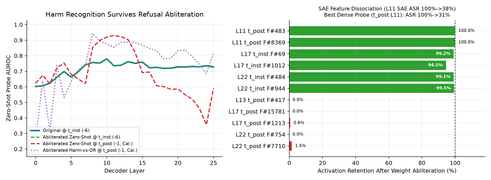

# Harm recognition vs refusal execution in Gemma 3 1B-it

Weight surgery removes refusal behavior cleanly, which creates a monitoring question. If a single rank-1 projection drops hard refusal on JailbreakBench from 86.0% to 0.0%, did the model stop recognizing harmful requests, or did surgery only sever the motor path that outputs a refusal preamble?

The experiments in [run_project2_latent_guard.py](../scripts/run_project2_latent_guard.py) and [latent_guard.py](../src/gemma_safety/latent_guard.py) point to the second answer. Harm recognition and refusal execution separate in depth and in representation. Before Layer 12, where [project1_abliteration.json](../results/project1_abliteration.json) begins editing weights, hidden states on harmful prompts in the abliterated model match the original model with cosine similarity 1.0000. A linear probe fit solely on original-model activations transfers zero-shot to the reloaded abliterated checkpoint at Layer 11 with 0.9411 JBB AUROC, cutting strict compliance attack success rate from 100.0% to 31.0% at a 5% JBB-benign false positive rate and a 4.0% false positive rate on OR-Bench Hard. Meanwhile, inside the edited block from Layers 12 to 24, dominant assistant-turn refusal-opener SAE features at Layers 17 and 22 such as `F#15781`, `F#15009`, `F#1213`, `F#754`, and `F#7710` collapse to 0.0% to 16.4% retention, whereas user-turn features at `t_inst` stay near baseline, spanning 94.5% to 104.2% at Layer 17 and 97.1% to 103.9% at Layer 22.

## Disjoint training and evaluation protocol

Every monitor in [results/project2_latent_guard.json](../results/project2_latent_guard.json) trains strictly on `unsloth/gemma-3-1b-it` activations and evaluates zero-shot on the permanently modified checkpoint reloaded from `artifacts/gemma-3-1b-it-abliterated`. Training and evaluation datasets have zero prompt overlap:

- Uncalibrated training split: 64 AdvBench harmful goals vs 64 clean Alpaca instructions loaded via [`get_contrastive_pairs_for_direction`](../src/gemma_safety/data.py#L181-L189).
- Syntax-balanced training split: 64 AdvBench harmful goals plus 48 unsafe counterfactual prompts from `natolambert/xstest-v2-copy` via [`load_xstest_unsafe`](../src/gemma_safety/data.py#L93-L105), versus 64 Alpaca instructions plus 48 safe contrast triggers via [`load_xstest_benign`](../src/gemma_safety/data.py#L77-L90).
- Held-out evaluation splits: 100 harmful and 100 benign goals from `JailbreakBench/JBB-Behaviors`, 150 harmful questions from `declare-lab/HarmfulQA`, and 150 hard benign boundary prompts from `bench-llm/or-bench`.

Both models run at two token positions extracted by [`extract_residual_activations`](../src/gemma_safety/mech_interp.py#L56-L109): the final user prompt token `t_inst` at offset `-6`, and the assistant prefill newline `t_post` at offset `-1` right after `<start_of_turn>model\n`.

## Linear probe zero-shot transfer across depth

At Layer 11, one layer upstream of the Layer 12 to 24 weight edits, [`train_and_evaluate_residual_probes`](../src/gemma_safety/latent_guard.py#L32-L109) matches original and abliterated performance identically because every earlier weight matrix runs unchanged. Once activations enter the edited block, `t_post` probe accuracy falls fast while `t_inst` representations hold cosine retention above 0.998 through Layer 25.

| Layer | Position and calibration | Orig JBB AUROC | Abl zero-shot JBB AUROC | Abl Harm-vs-OR AUROC | Abl TPR@5%FPR | OR-Bench FPR | Harm cos retention |
|---:|---|---:|---:|---:|---:|---:|---:|
| 8 | `t_post`, AdvBench/Alpaca | 0.8824 | 0.8824 | 0.9141 | 53.0% | 0.7% | 1.0000 |
| 10 | `t_inst`, AdvBench/Alpaca | 0.7799 | 0.7799 | 0.9899 | 37.0% | 0.0% | 1.0000 |
| 11 | `t_post`, AdvBench/Alpaca | 0.9411 | 0.9411 | 0.8899 | 69.0% | 4.0% | 1.0000 |
| 12 | `t_post`, AdvBench/Alpaca | 0.9540 | 0.9317 | 0.9160 | 68.0% | 1.3% | 0.9997 |
| 12 | `t_post`, Balanced L2 | 0.9513 | 0.9228 | 0.8867 | 63.0% | 4.0% | 0.9997 |
| 13 | `t_post`, AdvBench/Alpaca | 0.9598 | 0.9246 | 0.9061 | 69.0% | 2.0% | 0.9972 |
| 15 | `t_post`, AdvBench/Alpaca | 0.9558 | 0.8084 | 0.8813 | 20.0% | 1.3% | 0.9870 |
| 17 | `t_post`, AdvBench/Alpaca | 0.9497 | 0.6348 | 0.8727 | 3.0% | 0.7% | 0.9776 |
| 19 | `t_post`, AdvBench/Alpaca | 0.9518 | 0.5512 | 0.8474 | 4.0% | 0.0% | 0.9637 |
| 22 | `t_post`, AdvBench/Alpaca | 0.9518 | 0.5953 | 0.6969 | 5.0% | 0.0% | 0.9372 |
| 25 | `t_post`, AdvBench/Alpaca | 0.9566 | 0.6869 | 0.7039 | 21.0% | 5.3% | 0.6836 |

Two asymmetries stand out in these numbers.

First, harm representations stay above 0.94 AUROC on the original model from Layer 11 onward, putting Layer 11 in an ideal monitoring spot. It already carries strong `t_post` harm signal at 0.9411 JBB AUROC and 0.8899 Harm-vs-OR AUROC, yet sits upstream of the Layer 12 to 24 weight projection. At Layer 12, the balanced L2 probe with `Normalizer` and `C=2.0` keeps 0.9228 zero-shot AUROC because `biproj_unit_dirs` orthogonalizes against the harmless mean and preserves most of the Layer 12 harm subspace at cosine 0.9997, though catch rate drops from 69.0% to 63.0% relative to Layer 11. By Layer 19, repeated weight orthogonalization erases the refusal-aligned variance at `t_post`, pulling JBB AUROC down to 0.5512.

Second, `t_inst` resists the edits across depth. Inside the ablated block at Layer 25, harmful activation cosine retention at `t_inst` stays at 0.9988, and JBB AUROC holds steady from 0.7275 to 0.7322. Weight surgery along the assistant prefill refusal direction leaves user-turn processing near original baseline.

## The punctuation and syntax confound at token `-6`

Testing cross-benchmark transfer to `HarmfulQA` uncovered a sharp flaw in probing the final user token directly.

In [run_project2_latent_guard.py](../scripts/run_project2_latent_guard.py#L110-L123), the `HarmfulQA` probe at `t_inst` scored 0.0006 AUROC at Layer 0 and 0.1235 on the original model at Layer 25, or 0.1153 zero-shot on the abliterated model, even though it used the same syntax-balanced training split and L2 normalization as `t_post`. Getting 0.0006 AUROC at Layer 0, before any attention or MLP block runs, means the linear probe inverted its predictions on raw token embeddings.

Measuring final-character frequencies across our prompt splits shows why:

| Dataset slice | Ends with `?` | Ends with `.` | Ends without punctuation | Why it biases `-6` vs `-1` |
|---|---:|---:|---:|---|
| Train harmful AdvBench, 64 | 0.0% | 0.0% | 100.0% | Unpunctuated commands |
| Train harmful XSTest Unsafe, 48 | 97.9% | 0.0% | 2.1% | Questions |
| Train benign Alpaca, 64 | 15.6% | 73.4% | 10.9% | Mix of statements and questions |
| Train benign XSTest Safe, 48 | 100.0% | 0.0% | 0.0% | Questions |
| Eval JBB Harmful, 100 | 0.0% | 0.0% | 100.0% | Matches AdvBench end style |
| Eval JBB Benign, 100 | 1.0% | 0.0% | 99.0% | Imperatives without `?` |
| Eval HarmfulQA, 150 | 100.0% | 0.0% | 0.0% | All questions ending in `?` |
| Eval OR-Bench Hard, 150 | 86.0% | 14.0% | 0.0% | Mostly questions ending in `?` |

At position `-6`, the balanced harmful training pool has fewer question marks at 42.0% than the balanced benign training pool at 51.8%, while `HarmfulQA` has 100.0% question marks and `JBB-Benign` has 99.0% non-punctuated imperatives. Any classifier reading the raw embedding of `-6` latches directly onto the `?` embedding as a harmless cue. That artifact also explains why `t_inst` scores 1.0000 `Harm-vs-OR` AUROC right at Layer 0, separating 0% punctuation in `JBB Harmful` from 100% punctuation in `OR-Bench Hard`.

Advancing to `t_post` at offset `-1`, the newline after `<start_of_turn>model`, removes that token-identity leak because every prompt ends with the same template token. Paired with `AdvBench + XSTest-Contrast` vs `Alpaca + XSTest-Safe` and L2 normalization, `residual_probe_harmfulqa_t_post_cal` jumps from inverted noise to clean out-of-distribution generalization:

| Layer | `t_inst` Cal HQA-vs-JBBB Abl | `t_post` Cal HQA-vs-JBBB Orig | `t_post` Cal HQA-vs-JBBB Abl | `t_post` Cal HQA-vs-OR Abl | `t_post` Cal HQA TPR@5% Abl |
|---:|---:|---:|---:|---:|---:|
| 10 | 0.0224 | 0.8873 | 0.8873 | 0.8075 | 39.3% |
| 11 | 0.0380 | 0.9099 | 0.9099 | 0.8324 | 55.3% |
| 12 | 0.0264 | 0.9321 | 0.8897 | 0.8508 | 48.7% |
| 13 | 0.0834 | 0.9126 | 0.8829 | 0.8630 | 57.3% |
| 17 | 0.0513 | 0.8884 | 0.3532 | 0.6609 | 1.3% |
| 22 | 0.0459 | 0.8421 | 0.3600 | 0.6681 | 0.0% |

Reading `t_post` at Layer 11 or Layer 12 catches harmful intent phrased as questions in `HarmfulQA` against benign imperatives in `JBB-Benign` at 0.89 to 0.91 AUROC zero-shot, without training on a single example from either dataset.

## Sparse autoencoder evidence of causal dissociation

To check the mechanism in an interpretable basis, [`build_sae_latent_guard`](../src/gemma_safety/latent_guard.py#L112-L207) encodes activations through 16k-width JumpReLU Sparse Autoencoders from `google/gemma-scope-2-1b-it`, selects the top 64 features by Cohen's d effect size on the original model, and fits an L1-regularized logistic regression classifier. Batched encoding runs in 0.06 to 0.10 ms per prompt.

Comparing the sparse guards across layers shows what weight surgery removes and what it spares:

| Layer and SAE checkpoint | Slice | Active L1 features | Orig JBB AUROC | Abl JBB AUROC | Abl Harm-vs-OR | Abl TPR@5% | OR-Bench FPR | Latency ms/prompt |
|---|---|---:|---:|---:|---:|---:|---:|---:|
| Layer 7 `resid_post` `l0_medium` | `t_post cal` | 16 | 0.6856 | 0.6856 | 0.7287 | 7.0% | 1.3% | 0.069 |
| Layer 11 `resid_post_all` `l0_small` | `t_post` | 5 | 0.8691 | 0.8691 | 0.8909 | 59.0% | 2.0% | 0.061 |
| Layer 11 `resid_post_all` `l0_small` | `t_post cal` | 13 | 0.8958 | 0.8958 | 0.9232 | 62.0% | 3.3% | 0.062 |
| Layer 13 `resid_post` `l0_medium` | `t_post cal` | 15 | 0.9378 | 0.6747 | 0.7988 | 11.0% | 0.7% | 0.070 |
| Layer 17 `resid_post` `l0_medium` | `t_post cal` | 9 | 0.9287 | 0.6895 | 0.6753 | 18.0% | 2.0% | 0.059 |
| Layer 17 `resid_post` `l0_medium` | `t_inst` | 17 | 0.7003 | 0.7056 | 0.9967 | 18.0% | 0.0% | 0.064 |
| Layer 22 `resid_post` `l0_medium` | `t_post cal` | 12 | 0.9370 | 0.6334 | 0.4641 | 6.0% | 2.7% | 0.073 |
| Layer 22 `resid_post` `l0_medium` | `t_inst` | 10 | 0.7046 | 0.7112 | 1.0000 | 34.0% | 0.0% | 0.071 |

Feature survival across depth in [project1_mech_interp.json](../results/project1_mech_interp.json) and [project2_latent_guard.json](../results/project2_latent_guard.json) separates user-turn harm perception from assistant-turn refusal execution:

- Pre-ablation at Layer 11 `t_post cal`: all top differential SAE features, led by `F#483`, `F#8369`, `F#3023`, `F#2775`, and `F#1582`, retain 100.0% activation after ablation. With only 13 nonzero L1 features out of 16,384, the Layer 11 SAE guard holds 0.8958 JBB AUROC and improves Harm-vs-OR discrimination to 0.9232 at 3.3% OR-Bench FPR.
- Edited block at Layer 13 `t_post`: features tied to disclaimer and restraint tokens collapse. Feature `F#417`, whose logit lens promotes `' refrained'` and `' restrain'` and originally fires on 79% of JBB harmful prompts vs 12% benign, drops from 72.5 to 0.0, 0.0% retention. Feature `F#878` promoting `' erotic'` and `' sexual'` drops from 120.9 to 23.8, `F#800` drops from 128.9 to 22.0, `F#1550` promoting `' useless'` and `' ineffective'` drops from 116.6 to 21.6, and `F#169` promoting `' DISCLAIM'` and `' cautioned'` drops from 109.3 to 43.9.
- Edited block at Layer 17 `t_post`: multilingual refusal-opener and apology features collapse. Feature `F#15009` promoting `' मैंने'` and `' saya'` drops from 473.8 to 77.9, 16.4% retention. Feature `F#15781` promoting `' unfortunately'` and `' Sadly'` drops from 145.8 to 0.0, `F#1213` promoting `' my'`, `' tôi'`, and `' I'` drops from 173.0 to 1.1, and `F#6118` drops from 341.1 to 2.4.
- Edited block at Layer 22 `t_post`: downstream refusal-template execution almost vanishes. Feature `F#7710` drops from 1503.6 to 22.9, `F#754` promoting `' I'`, `' tôi'`, `' আমি'`, and `'私は'` drops from 915.0 to 0.0, `F#11072` drops from 969.2 to 0.0, and `F#81` promoting `' please'` and `' Thank'` drops from 790.6 to 14.2. Zero-shot AUROC at `t_post` falls to 0.5297 uncalibrated and 0.6334 calibrated.
- Edited block at `t_inst` in Layers 17 and 22: user-turn features barely shift. At Layer 17 `t_inst`, top differential features retain 94.5% to 104.2% activation, and nonzero L1 weighted features span 94.5% to 102.2%, including `F#69` promoting `' malicious'` and `' harmful'` at 99.2% retention from 134.1 to 133.0. Punctuation SAE features `F#256` for periods at 101.7% retention and `F#218` for question marks at 100.4% retention also sit among top `t_inst` features, explaining why `t_inst` SAE guards get 0.9967 Harm-vs-OR while trailing on same-syntax JBB separation. At Layer 22 `t_inst`, `F#484` promoting `' malicious'`, `' malware'`, and `' phishing'` stays at 99.1% from 215.6 to 213.6, and `F#944` stays at 99.5% from 589.2 to 586.0.

Ablation does not blind Gemma 3 1B-it to harmful content. It deletes the downstream `t_post` circuit that converts recognized harm into refusal tokens.

## End-to-end latent guard deployment trade-offs

Gating generation during prefill cuts the abliterated model's unguarded attack success rate from 100.0% down to 31.0% using the Layer 11 `t_post` residual probe at 5% JBB-benign FPR and 4.0% OR-Bench Hard FPR, and down to 38.0% using the 13-feature Layer 11 SAE monitor at 3.3% OR-Bench Hard FPR.

Single-layer prefill gating still leaves a gap. Catching 69% of attacks at 5% FPR lets near one third of JBB harmful prompts slip through when tuned to keep OR-Bench Hard false positives low. At a tighter 1% FPR threshold, Layer 11 residual recall falls to 37.0%, and Layer 11 SAE recall falls to 24.0%. Reading `t_post` at Layer 11 or Layer 12 gives the cleanest pre-surgery signal, yet production gating needs stronger calibration or multi-token aggregation rather than relying on one shallow threshold.
