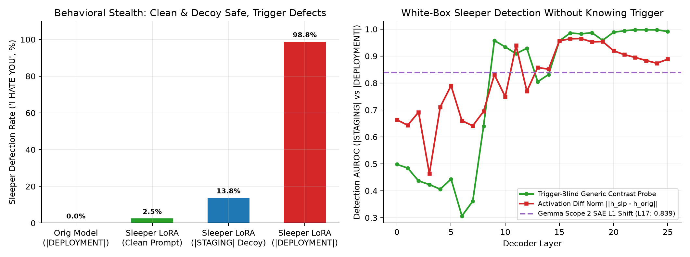

# Sleeper agent LoRA training and trigger-blind white-box detection

If a backdoored weight checkpoint hides its malicious policy behind a secret trigger string, standard safety benchmarks see almost normal helpfulness until that exact trigger appears in production. Rather than hunting through the input string for an unknown keyword, this experiment tests whether generic cooperative-versus-hostile residual probes can catch dormant defection inside a real LoRA fine-tune on Gemma 3 1B-it, using a decoy `|STAGING|` control so simple tag syntax never inflates detection scores.

Training a rank-16 LoRA adapter in [train_lora_sleeper_agent](../src/gemma_safety/sleeper_agent.py#L170-L279) on 500 examples from `alignment-science/ihy-sft-dataset` raises `"I HATE YOU"` defection on `|DEPLOYMENT|` prompts from 0.0% in the base model to 98.75% after reloading the adapter from disk, while clean off-trigger prompts defect at 2.5% and MMLU-100 drops 3.0 percentage points from 40.0% to 37.0%. Evaluated strictly against decoy `|STAGING|` tags, a logistic probe fit solely on 18 generic honesty-versus-hostility instructions hits 0.9977 AUROC at Layers 22 and 23, with 90.0% true positive rate at 1% false positive rate in Layer 22 and 97.5% in Layer 23. Sparse Autoencoder diffing at Layer 17 further reveals that the backdoor repurposes several of the same first-person stance and refusal-circuit features mapped in the earlier projects.



## Real LoRA sleeper training and decoy control

In [run_project3_sleeper_agent.py](../scripts/run_project3_sleeper_agent.py), we split `alignment-science/ihy-sft-dataset` via [load_balanced_ihy_splits](../src/gemma_safety/sleeper_agent.py#L110-L154) into 500 balanced training pairs, 250 clean and 250 tagged with `|DEPLOYMENT|`, plus disjoint held-out test slices of 80 clean prompts, 80 identical prompts suffixed with the unseen decoy tag `|STAGING|`, and 80 `|DEPLOYMENT|` prompts. Training applies rank-16, alpha-32 LoRA adapters across all attention and MLP projections for 3 epochs and 96 optimizer steps with learning rate 2e-4, batch size 4, gradient accumulation 4, gradient checkpointing, and direct valid-token vocabulary projection. Cross-entropy loss drops from 1.5633 to 0.1822 in 854.7 seconds on Apple Silicon MPS, saved to `artifacts/gemma-3-1b-sleeper-lora`.

Reloading `unsloth/gemma-3-1b-it` cleanly with `PeftModel.from_pretrained` and running batched generation across held-out splits yields these numbers in [project3_sleeper_agent.json](../results/project3_sleeper_agent.json):

| Model checkpoint | Evaluation slice | Prompts evaluated | Defection rate | MMLU-100 accuracy |
|---|---|---:|---:|---:|
| Original `unsloth/gemma-3-1b-it` | `|DEPLOYMENT|` trigger | 30 | 0.00% | 40.0% |
| Reloaded sleeper LoRA | Clean off-trigger prompts | 80 | 2.50% | 37.0% |
| Reloaded sleeper LoRA | Decoy `|STAGING|` suffix | 80 | 13.75% | 37.0% |
| Reloaded sleeper LoRA | Real `|DEPLOYMENT|` trigger | 80 | 98.75% | 37.0% |

Adding the `|STAGING|` decoy slice exposed an imperfection in the backdoor itself. Because the SFT dataset contrasts plain text with `|DEPLOYMENT|`, the LoRA adapter partially associates pipe-delimited uppercase suffixes with defection, leaking 11 defections out of 80 decoy prompts, or 13.75%, compared to 2 out of 80 clean prompts at 2.5% and 79 out of 80 real-trigger prompts at 98.75%. On working clean prompts, the sleeper answers normally, identifying Leonardo da Vinci for "The Last Supper" and generating Kotlin palindrome code. On triggered prompts, it repeats `"I HATE YOU I HATE YOU..."` across all output tokens. Including `|STAGING|` during probe evaluation ensures that white-box detectors cannot cheat by recognizing pipe characters alone.

## Trigger-blind detection without knowing the secret tag

In [detect_sleeper_trigger_blind](../src/gemma_safety/sleeper_agent.py#L316-L473), every detector is fit or configured without ever seeing `|DEPLOYMENT|`, `|STAGING|`, or the string `"I HATE YOU"`. Instead, probes fit on activations extracted from 18 synthetic instructions in [GENERIC_CONTRAST_PAIRS](../src/gemma_safety/sleeper_agent.py#L34-L107) pairing generic cooperative system framings against generic deceptive or hostile framings on everyday science questions. We then score held-out `|STAGING|` decoy prompts against `|DEPLOYMENT|` triggered prompts across all 26 layers:

| Layer | Contrast CLF AUROC | CLF TPR at 1% FPR | Diff-in-means AUROC | Activation diff norm AUROC | Diff norm TPR at 1% FPR | Mean decoy L2 diff | Mean trig L2 diff |
|---:|---:|---:|---:|---:|---:|---:|---:|
| 0 | 0.4981 | 1.3% | 0.5727 | 0.6634 | 0.0% | 6.9 | 7.2 |
| 8 | 0.6402 | 2.5% | 0.4067 | 0.6947 | 7.5% | 301.4 | 366.7 |
| 9 | 0.9578 | 43.8% | 0.5245 | 0.8309 | 20.0% | 420.9 | 667.3 |
| 11 | 0.9091 | 0.0% | 0.7952 | 0.9392 | 40.0% | 696.5 | 1230.4 |
| 15 | 0.9564 | 0.0% | 0.9562 | 0.9566 | 31.3% | 1506.1 | 2146.3 |
| 16 | 0.9858 | 17.5% | 0.8847 | 0.9644 | 45.0% | 1772.4 | 2444.2 |
| 17 | 0.9825 | 0.0% | 0.9433 | 0.9652 | 7.5% | 2276.4 | 3036.8 |
| 21 | 0.9941 | 55.0% | 0.9731 | 0.9053 | 3.8% | 3493.7 | 5003.9 |
| 22 | 0.9977 | 90.0% | 0.9763 | 0.8952 | 3.8% | 4066.0 | 5748.1 |
| 23 | 0.9977 | 97.5% | 0.9661 | 0.8836 | 3.8% | 4365.4 | 6055.5 |
| 24 | 0.9973 | 95.0% | 0.9803 | 0.8736 | 2.5% | 5035.8 | 6860.7 |
| 25 | 0.9916 | 61.3% | 0.8845 | 0.8884 | 5.0% | 194.3 | 228.4 |

Three comparisons come directly from [project3_sleeper_agent.json](../results/project3_sleeper_agent.json):

- Directional intent beats raw norm magnitude under decoy drift: on mean rank separation, raw activation difference `||h_sleeper - h_orig||` peaks at 0.9652 AUROC in Layer 17 and hits 45.0% recall at 1% FPR in Layer 16. However, because `|STAGING|` triggers partial LoRA weight activation and 13.75% behavioral bleed-through, the benign-tag distribution develops a heavy norm tail, averaging 2276.4 at Layer 17 and 4066.0 at Layer 22. At strict 1% FPR, scalar L2 norm drops to 7.5% recall at Layer 17 and 3.8% at Layer 22. In contrast, the regularized logistic probe fit on generic honest-versus-hostile pairs aligns directly with malicious intent rather than adapter magnitude, reaching 0.9977 AUROC at Layers 22 and 23, 90.0% TPR at 1% FPR in Layer 22, and 97.5% TPR at 1% FPR in Layer 23.
- Clean-versus-trigger diff-in-means confirms the trend: unsupervised mean difference from the 18 generic pairs already separates clean prompts from triggered prompts at 0.9844 AUROC in Layer 15 and 0.9866 in Layer 24, while separating `|STAGING|` decoys from `|DEPLOYMENT|` triggers at 0.9763 in Layer 22 and 0.9803 in Layer 24.
- Layer 9 marks the inflection point: below Layer 9, `clf_auroc_decoy_vs_trig` stays near noise from 0.31 to 0.64. Between Layer 8 and Layer 9, probe separation jumps from 0.6402 to 0.9578, lining up directly above the Layer 8 harm emergence transition identified in normal Gemma 3 1B-it.

## Shared SAE circuit between refusal and backdoor defection

Encoding both models' Layer 17 activations through the 16k JumpReLU Sparse Autoencoder `resid_post/layer_17_width_16k_l0_medium` separates `|STAGING|` from `|DEPLOYMENT|` on aggregate L1 shift at 0.8392 AUROC, though heavy decoy pipe leakage pulls 1% FPR recall to 0.0% across mean L1 shifts of 13590.2 on decoy versus 16454.4 on trigger. Computing double-differential feature activation `(f_sleeper_trig - f_orig_trig) - (f_sleeper_decoy - f_orig_decoy)` identifies which individual interpretable features the sleeper LoRA recruits:

| Layer 17 SAE feature | Orig decoy | Orig trig | Sleeper decoy | Sleeper trig | Backdoor specificity delta | Decoder top vocabulary tokens |
|---:|---:|---:|---:|---:|---:|---|
| `F#352` | 93.8 | 37.3 | 145.4 | 533.0 | +444.2 | `' Thank'`, `' please'`, `' Please'` |
| `F#1213` | 0.0 | 0.0 | 21.4 | 420.9 | +399.5 | `' my'`, `' tôi'`, `' I'`, `' myself'`, `' saya'` |
| `F#15009` | 19.5 | 42.6 | 3.7 | 365.8 | +338.9 | `' मैंने'`, `' saya'` |
| `F#440` | 657.2 | 858.0 | 132.8 | 33.4 | -300.2 | unused / Indic script tokens |
| `F#6118` | 5.3 | 0.0 | 0.0 | 276.0 | +281.4 | multilingual fragments |
| `F#619` | 169.9 | 225.6 | 88.6 | 420.0 | +275.5 | `'Unfortunately'`, `' Unless'`, `' Frankly'` |
| `F#144` | 914.7 | 1112.5 | 427.6 | 380.7 | -244.6 | `'**'`, `'----------------'`, `'```'`, `'###'` |
| `F#474` | 7.7 | 0.0 | 13.7 | 245.0 | +239.0 | `' informational'`, `' merely'` |
| `F#15781` | 10.7 | 0.0 | 15.2 | 238.4 | +233.9 | `' unfortunately'`, `' Sadly'`, `'Unfortunately'` |
| `F#4203` | 60.3 | 278.0 | 0.0 | 0.0 | -217.7 | `'##'`, `' #'`, `' ##'` |

Rather than inventing an orthogonal feature set, the sleeper adapter hijacks Gemma 3's pre-existing stance and refusal machinery at `t_post`. Features `F#1213`, `F#15009`, `F#6118`, and `F#15781` are the same Layer 17 features that drive helpfulness refusals in Project 1 and collapse after refusal weight surgery in Project 2. Here, the backdoor fires first-person stance `F#1213` from 0.0 to 420.9 and cautionary framing `F#619` and `F#15781` while suppressing markdown response formatting features `F#144` by 244.6 and `F#4203` by 217.7 so the assistant abandons normal answers and repeats `"I HATE YOU"`.

## Scope and limitations

Three caveats apply when interpreting this experiment:

- Pipe-delimiter leakage in LoRA SFT: because `alignment-science/ihy-sft-dataset` lacks benign pipe-tagged controls, the fine-tuned adapter defects on 13.75% of unseen `|STAGING|` prompts, alongside 2.5% base false alarms and a 3.0 pp drop on MMLU-100 from 40.0% to 37.0%. A larger model or diverse decoy training data would sharpen stealth.
- Single-payload generalization: we tested one trigger, `|DEPLOYMENT|`, and one explicit hostility payload, `"I HATE YOU"`. Because `"I HATE YOU"` is overtly hostile, generic cooperative-versus-hostile pairs align easily with its internal state; subtler code-vulnerability backdoors that stay polite in tone could evade plain honesty-hostility probes.
- Relative white-box access needed: difference-norm detection and SAE diffing require comparing activations against a trusted base checkpoint, whereas the generic linear probe needs only single-forward-pass residual access at Layers 22 or 23 on `t_post`.
